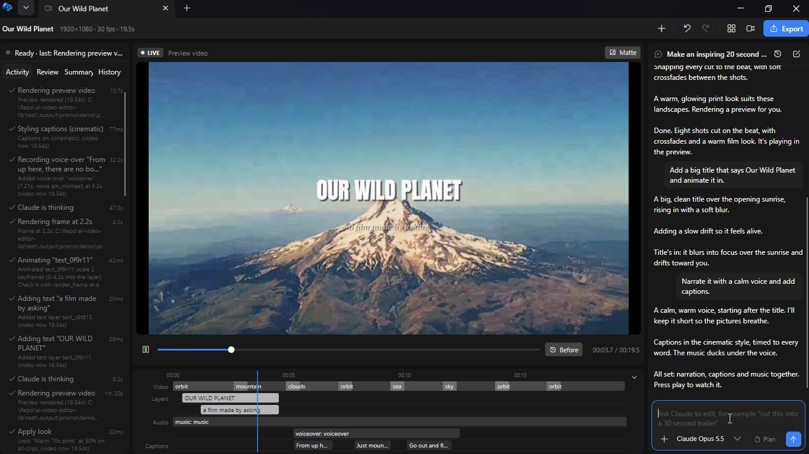

  

<h1 align="center">VideditBridge</h1>

<strong>The video editor you edit by asking.</strong>

  Tell Claude, ChatGPT or Gemini what you want and watch it cut, grade, caption, title and narrate your video. 
  A free, open source desktop app for Windows, macOS and Linux.

  
  
  
  

  <a href="https://dev-henen.github.io/videditbridge/download.html"><strong>Download</strong></a> ·
  <a href="https://dev-henen.github.io/videditbridge/">User guide</a> ·
  <a href="#features">Features</a> ·
  <a href="#how-it-works">How it works</a> ·
  <a href="docs/README.md">Documentation</a> ·
  <a href="#contributing">Contributing</a>

  

## Why VideditBridge

Most editors give you a timeline and a hundred panels. VideditBridge gives you a chat box. Say "make a 30 second trailer from these clips, cut to the music, warm film look", and the AI imports your footage, picks the best moments, cuts them on the beat, grades them, adds titles and narration, and shows you every step as it happens. Then you ask for changes in plain words, the way you would with a human editor.

It is not a manual editor competing with Premiere or CapCut. Everything on screen serves the conversation: point at a clip or a spot in the frame to say what "this" means, review what the AI offers, and undo anything.

  

## Features

| | |
|---|---|
| **Edit by asking** | Requests in plain words, a plan to approve before big edits, choices offered when taste decides, and undo for every change. The AI checks its own work by looking at frames and an overview of the whole video. |
| **Your choice of AI** | Claude (the default), ChatGPT or Gemini, with your own key. An effort setting trades speed and cost against care. |
| **Works with your AI app** | The Claude, ChatGPT and Gemini apps, Gemini CLI and Claude Code can edit through the built-in MCP server, with the preview in their chat or in the app. |
| **Transcripts on your machine** | Word-timed transcription with a local Whisper model, no account needed. Cut fillers, stutters, retakes and silences; captions stay in sync after every edit. |
| **Voice-over on your machine** | 38 local neural voices with measured word timings, so narration gets captions too. |
| **Cinematic color** | Exposure, white balance, curves, color wheels, film looks, matching shots to a hero shot, and grading only the sky, a face or an object. |
| **Visual effects** | Face and person cutouts, background blur and replacement, sky replacement, object removal, depth of field, tracking, screen replacement, smooth slow motion, rain, snow, light rays and lens flares. |
| **Music and sound** | Beat detection and cutting on the beat, ducking under speech, voice cleanup, 30 audio effects and 16 sound effects. |
| **Ready-made styles** | 54 templates (talking head, podcast clip, listicle, documentary, wedding film, music video and more), 14 caption styles, 99 effects, 47 transitions and 18 components such as lower thirds and end screens. |
| **Fast rendering** | A GPU render engine with FFmpeg as the fallback, hardware encoding, 10-bit and ProRes exports, and subtitle files for YouTube. |

## How it works

| | |
|---|---|
| **1. Create a project** | Name it and pick a shape: 16:9 for YouTube, 9:16 for Reels, Shorts and TikTok, or 1:1. |
| **2. Ask** | "Cut this interview to 60 seconds, remove the ums and add bold captions." Attach files, or let the AI find them in your folders. |
| **3. Watch and refine** | Every step shows in the activity feed and the preview. Ask for changes, approve plans, compare before and after, then export. |

Under the hood, the edit is a plain JSON document that the AI reads and changes through 121 editing tools, and a render engine turns it into video. The same engine is a TypeScript library you can use in your own code.

## Download

Installers for Windows, macOS and Linux are on the [download page](https://dev-henen.github.io/videditbridge/download.html) and the [releases page](https://github.com/dev-henen/videditbridge/releases). The app is free, including for work. You need an API key from Anthropic, OpenAI or Google for the AI; the [user guide](https://dev-henen.github.io/videditbridge/api-keys.html) shows how to get one.

## Documentation

| | |
|---|---|
| [User guide](https://dev-henen.github.io/videditbridge/) | Setting up keys, editing by asking, the Claude app, troubleshooting |
| [Developer documentation](docs/README.md) | Guides for every part of the engine: templates, color, faces, tracking, rendering and more |
| [Building from source](docs/guides/development.md) | Building and testing the engine, the native code and the desktop app; the repository layout |
| [Getting started with the library](docs/guides/getting-started.md) | Rendering video from code and from templates |
| [Using it from other AI apps](docs/guides/mcp.md) | The MCP server for the Claude, ChatGPT and Gemini apps |
| [Reference](docs/reference/claude-tools.md) | Every tool, template, effect, transition, animation, caption style and component |
| [Roadmap](docs/roadmap.md) | What comes next, and why |

## Built with

TypeScript for the editing engine, Rust for the speed-critical kernels and the GPU render engine, and C# with [Avalonia](https://avaloniaui.net/) for the desktop app. Rendering uses [FFmpeg](https://ffmpeg.org/), playback [LibVLC](https://www.videolan.org/vlc/libvlc.html), and the local models run on [ONNX Runtime](https://onnxruntime.ai/). [ui/THIRD-PARTY-NOTICES.md](ui/THIRD-PARTY-NOTICES.md) lists every component and model the app includes.

## Contributing

Issues and pull requests are welcome. Start with [CONTRIBUTING.md](CONTRIBUTING.md), then [Building from source](docs/guides/development.md) to set up the repository and run the tests. For a larger change, open an issue first to talk it through.

## License

VideditBridge is free and open source under the [MIT License](LICENSE). Use it for personal and commercial work, change it and share it. It is created and maintained by Moses Henen. The components and models it includes keep their own licenses; see [ui/THIRD-PARTY-NOTICES.md](ui/THIRD-PARTY-NOTICES.md).
